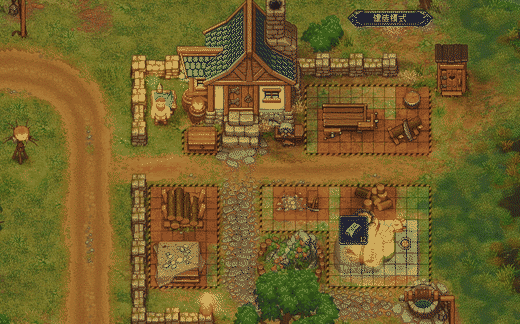

# Move Buildings

A [BepInEx 5](https://github.com/BepInEx/BepInEx) plugin for **Graveyard Keeper 1** that adds a *Move building* action
to the build desk window, so existing buildings can be relocated without demolishing and rebuilding them.

**Contents are preserved.** The mod never destroys or re-creates the object: it moves the very same
`WorldGameObject` instance and only refreshes the caches that depend on its position. A chest keeps its items, a
workbench keeps its craft queue and quality, a grave keeps its corpse, a zombie station keeps its worker link.

给《墓地守护者 1》加的 BepInEx 模组：在建造台界面里多出一行「移动建筑」，把已有建筑直接搬到新位置，
不拆除、不重建，所以箱子等容器里的物品全部保留。



## Install

1. Install BepInEx 5 for Graveyard Keeper.
2. Download `MoveBuildings.dll` from the [latest release](https://github.com/Jebearssica/graveyard-keeper-move-buildings/releases/latest)
   (or build it from source) and drop it into `BepInEx/plugins/MoveBuildings/`.
3. Start the game.

## Usage

1. Use a build desk to open the building window (the same window where *Remove* lives).
2. Click **Move building** (「移动建筑」) next to *Remove*.
3. The window closes and the building grid appears. Click a building to pick it up.
   - Mouse: move the preview, **left click** to place, **right click** to cancel.
   - Rotation keys rotate the preview when the object supports variations.
4. After a successful placement the pick mode stays active, so the next building can be picked right away. A rejected
   placement keeps the current building in hand. **Right click / Back** leaves the mode and reopens the build desk
   window.

## How contents survive a move

All persistent state of a building lives on its `WorldGameObject.data` (`Item`), e.g. a chest's contents in
`data.inventory`. On placement the mod only:

- writes the new `transform.position` (the same value the preview shows, without the vanilla rounding to a full cell)
- updates `variation` when the player actually rotated the preview
- refreshes position-dependent caches: `RefreshPositionCache`, `RecalculateGridShape`,
  `ChunkedGameObject.RecalculateChunk`, `UpdatePathCell` (A* navmesh), `RecalculateZoneBelonging` (zone membership and
  quality totals), sprite sorting and the interaction bubble

There is no `DestroyMe`, `SetObject` or other rebuild step, so containers, craft queues, quality, HP, parameters,
orientations and zombie-worker links stay untouched.

## What can be moved

By default: objects that can be produced by the build menu - i.e. an `ObjectCraftDefinition` with
`build_type == Put` whose `out_obj` matches the object id (ids are compared without the trailing `_place`, so both
finished objects and construction sites work). Graves are included as well: they have no craft of their own, so they
are matched by their grave interaction, and a buried body stays inside the object while it is carried. NPCs, mobs,
drops and scenery props are ignored.

Set `AllowNonBuildableObjects` to `true` to also allow any world object that only has a removal craft (trees, rocks,
quest props).

## Configuration

`BepInEx/config/gk.movebuildings.cfg`

| Key | Default | Meaning |
|---|---|---|
| `AllowNonBuildableObjects` | `false` | Also allow objects that only have a removal craft |
| `ShowBuildGrid` | `true` | Show the build grid while moving |
| `SelfTest` | `false` | Verification only: after loading a save, walks the build-UI move flow on an existing object and logs `PASS`/`FAIL` |

## Building from source

Against a real install (the default):

```powershell
dotnet build -c Release
```

The game directory is detected when the project sits inside it (for example `<game>/mods-work/MoveBuildings`),
otherwise the default Steam location is used; override it with `-p:GameDir="D:\Games\Graveyard Keeper"`. The build
copies the DLL into `BepInEx/plugins/MoveBuildings/` when BepInEx is installed.

Without the game, using the declaration-only stubs in `ci/refs` (this is what CI does):

```powershell
dotnet build -c Release -p:UseGameRefs=false -p:DeployToGame=false -p:BepInExCore="<extracted BepInEx>\core"
```

See [ci/README.md](ci/README.md) for how the stubs are generated.

Release builds are compiled with `DebugType=none` and a `PathMap`, so the assembly contains no local file paths.

## Implementation notes

- A Harmony postfix on `CraftGUI.AddRemoveBuildingItem` inserts the extra row in front of the vanilla *Remove* row
  (both list order and transform order), and a postfix on `CraftGUI.SwitchTab` keeps it visible on every craft tab
  (the vanilla *Remove* row gets the same special treatment).
- A Harmony prefix on `CraftGUI.OnCraft` turns the extra row into the pick mode instead of a craft.
- The move session owns the build zone while it runs, so it saves and restores the zone id, the zone and the zone
  multi-inventory together. `BaseCraftGUI.CanCraft()` reads `BuildModeLogics.multi_inventory` whenever a zone id is
  set, and `SetCurrentBuildZone()` does nothing for an unchanged id, so leaving that inventory behind makes every row
  of the next build window throw.
- Rows are deduplicated against the whole craft table, not only against `list_items`: the game only destroys rows it
  knows about, so a row that was never inserted would otherwise survive in the table forever.
- The row icon is a self-made 32x32 PNG embedded in the DLL, drawn in the vanilla build-tile style (blue tile, white
  four-direction arrow) and registered through `UI2DSprite.DrawAndResize`.
- The preview and the placement validation reuse the vanilla `FloatingWorldGameObject` API
  (`CreateFloatingWorldObjectById`, `MoveCurrentFloatingObject`, `RotateCurrentFloatingObject`), so the preview, grid
  snapping and red "cannot place" feedback match the normal build flow.
- Availability matches `FloatingWorldGameObject.RecalculateAvailability` (per-cell `BuildGrid.IsCellBusy` plus the
  zone test the build grid uses for its colours), with two deliberate differences: the object being moved - and
  anything it already overlapped - never blocks its own destination, and cells of its previous footprint are always
  accepted, so a building that shares ground with decorations can be nudged at all.
- Objects whose pivot sits outside every zone get the zone found under their footprint, so the zone rule still applies
  to them; only objects that really live outside all zones may move freely.
- The placement writes the preview position verbatim. `MoveWhenPlacingGlobalPos` rounds through
  `RoundAndSortComponent`, and a finished building snaps to a full 96 px cell while the preview only snaps to a third
  of it, which used to move the object up to half a cell away from where it was shown.
- The build grid is re-shown through one helper that moves it and recomputes its colours, because `RefreshGrid()`
  samples the world around the grid's current position; moving it without a refresh offset the coloured cells from the
  terrain.
- The original object's colliders are temporarily disabled while the preview is active (and restored afterwards) so it
  does not count as occupying its own target cells.
- Any error path runs the same teardown: stop the preview, restore colours/colliders, leave build mode.

## Limitations

- Objects can only be moved inside their original `WorldZone`.
- NPCs and mobs are never movable.
- A handful of quest props are hard-coded by position; the "buildable objects only" default keeps them out of reach.

## Development

`Demo.cs` is a recording and regression helper. It is compiled only with `-p:Demo=true` and is never part of a
release build. It loads the newest save and drives the mod through the engine instead of the mouse; the mode is picked
with the `GK_DEMO_MODE` environment variable:

- `play` (default) - replays a scripted move with moves of its own choosing, then reopens the build desk and dumps the
  resulting craft list.
- `dump` - opens the home build desk twice, the farm desk and the tavern desk, and dumps every craft list, so a window
  that keeps a leftover row or fails to lay out its rows is visible in the log (`items=` vs `children=`).
- `graves` / `gravemove` - dump the grave crafts and move a buried grave, logging the body item before and after.

Each dump prints `items=` (rows the game knows), `children=` (rows in the table) and per-row ids, so
`children = items + 1` is the expected, clean state.

## License

MIT - see [LICENSE](LICENSE).
